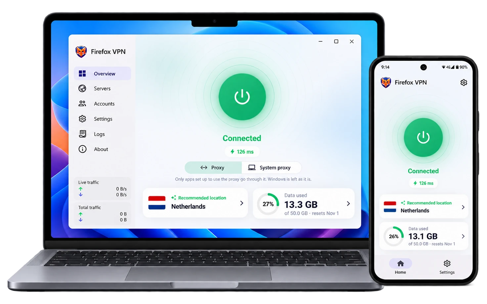
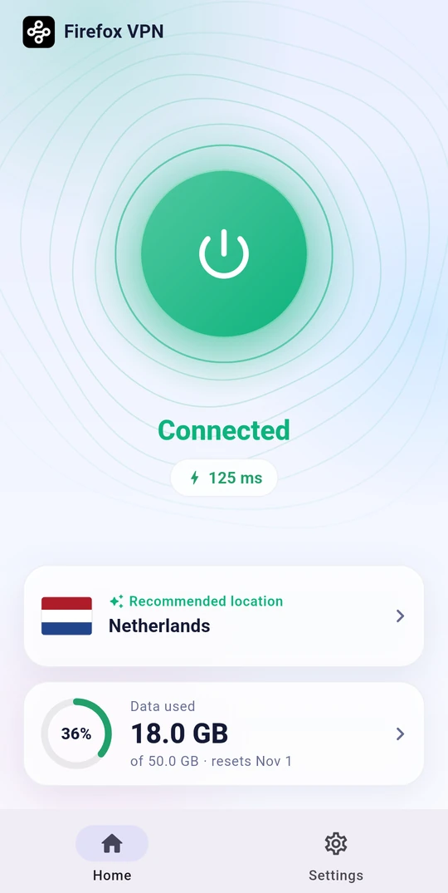
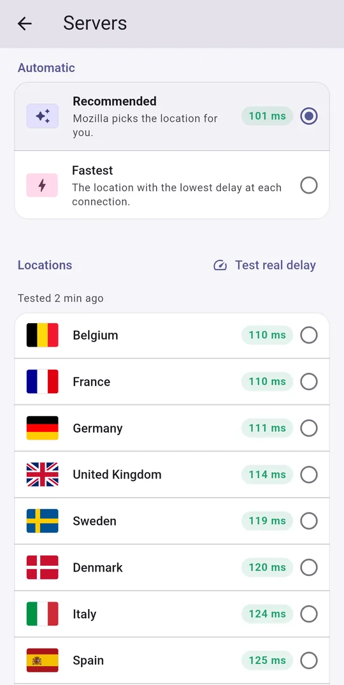
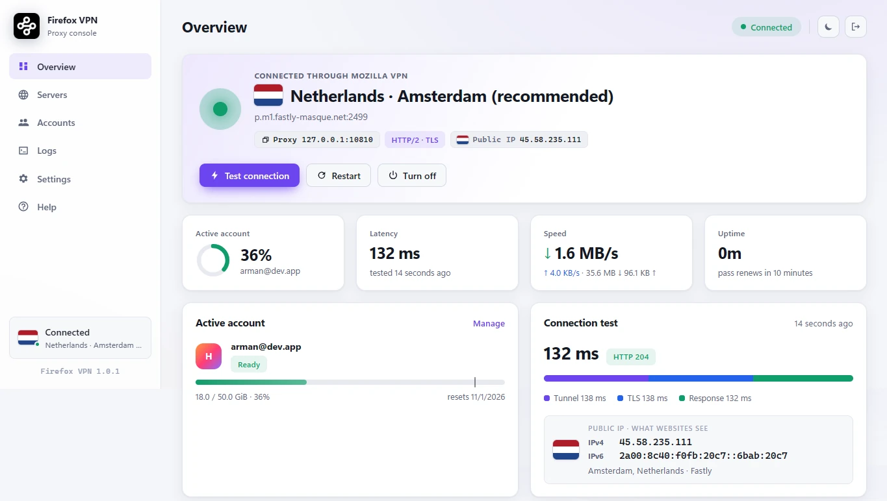

<div align="center">

[🇺🇸 English](../../README.md) &nbsp;/&nbsp; [🇮🇷 فارسی](README_fa.md) &nbsp;/&nbsp; [🇨🇳 简体中文](README_zh.md) &nbsp;/&nbsp; **🇷🇺 Русский**

</div>
<br>

<p align="center"></p>

<h1 align="center">Firefox VPN</h1>

<div align="center">

[](https://github.com/armanlife/firefox-vpn-client/releases)
[](https://github.com/armanlife/firefox-vpn-client/releases/latest)
[](../../LICENSE)

</div>

## Что такое Firefox VPN?

**Firefox VPN** — бесплатный VPN с открытым исходным кодом, который работает с аккаунтом Firefox (Firefox Account). Он передаёт ваш интернет-трафик через серверы Mozilla, на инфраструктуре **Fastly**, по защищённым туннелям **HTTP/2 и HTTP/3**.

Каждый аккаунт Firefox получает **50 ГБ бесплатного трафика в месяц**, а функция **мультиаккаунта** умножает этот объём: когда один заканчивается, следующий подключается **автоматически**.

Для **Android, Windows, macOS и Linux**; полностью бесплатно, без рекламы.

<p align="center"><a href="https://raw.githubusercontent.com/armanlife/firefox-vpn-client/main/docs/screenshots/main.webp" target="_blank"></a></p>

## 🚀 Основные возможности

✈️ Кроссплатформенность: Android, Windows, macOS и Linux

⭐ Очень простой в использовании, с понятным интерфейсом

🆓 Бесплатно: 50 ГБ в месяц на каждый аккаунт Firefox

➕ Мультиаккаунт: когда трафик одного аккаунта заканчивается, следующий подключается автоматически

🌐 Официальные серверы Mozilla: выбор страны с проверкой пинга или автоматический выбор лучшего сервера

⚡ Быстрое и стабильное соединение по HTTP/2 и HTTP/3

🔀 Умная маршрутизация: местные сайты открываются напрямую, быстрее и без расхода трафика

🔌 Несколько режимов подключения (VPN и прокси)

🔒 Зашифрованный DNS (DNS over HTTPS)

🌍 15 языков, включая английский, персидский, китайский и русский

🌙 Светлая и тёмная темы

🛡 Открытый исходный код, безопасность и развитие сообществом

🔄 Автоматическая проверка обновлений

## 📸 Скриншоты

<p align="center">
&nbsp;&nbsp;
&nbsp;&nbsp;

</p>

## 📥 Скачать

<table>
<thead>
<tr><th>Система</th><th>Скачать</th></tr>
</thead>
<tbody>
<tr><td>Android</td><td><a href="https://github.com/armanlife/firefox-vpn-client/releases/latest/download/Firefox-VPN-Android-universal.apk"></a><br><a href="https://github.com/armanlife/firefox-vpn-client/releases/latest/download/Firefox-VPN-Android-arm64-v8a.apk"></a><br><a href="https://github.com/armanlife/firefox-vpn-client/releases/latest/download/Firefox-VPN-Android-armeabi-v7a.apk"></a><br><a href="https://github.com/armanlife/firefox-vpn-client/releases/latest/download/Firefox-VPN-Android-x86_64.apk"></a></td></tr>
<tr><td>Windows</td><td><a href="https://github.com/armanlife/firefox-vpn-client/releases/latest/download/Firefox-VPN-Windows-Setup-x64.exe"></a><br><a href="https://github.com/armanlife/firefox-vpn-client/releases/latest/download/Firefox-VPN-Windows-x64.zip"></a></td></tr>
<tr><td>macOS</td><td><a href="https://github.com/armanlife/firefox-vpn-client/releases/latest/download/Firefox-VPN-macOS.dmg"></a></td></tr>
<tr><td rowspan="2">Linux</td><td><a href="https://github.com/armanlife/firefox-vpn-client/releases/latest/download/Firefox-VPN-Linux-amd64.tar.gz"></a><br><a href="https://github.com/armanlife/firefox-vpn-client/releases/latest/download/Firefox-VPN-Linux-arm64.tar.gz"></a></td></tr>
<tr><td><a href="https://github.com/armanlife/firefox-vpn-client/releases/latest/download/firefox-vpn-core-linux-amd64.tar.gz"></a><br><a href="https://github.com/armanlife/firefox-vpn-client/releases/latest/download/firefox-vpn-core-linux-arm64.tar.gz"></a></td></tr>
</tbody>
</table>

**Какой файл скачать?**

- **Android:** если не уверены, берите **Universal** — он устанавливается на любой телефон. **ARMv8** подходит для большинства современных телефонов и весит меньше.
- **Windows:** **Setup** — обычный установщик; **Portable** работает без установки из любой папки.
- **Linux:** **App** — для Linux с рабочим столом (с графической средой); **Core** — для сервера (без графической среды, с веб-панелью).

## 💻 Установка и обновление в Linux и macOS

> Пользователям Windows и Android этот раздел не нужен: возьмите установочный файл из таблицы «Скачать» выше.

```bash
curl -fsSL https://raw.githubusercontent.com/armanlife/firefox-vpn-client/main/install.sh | bash
```

### 🌐 Веб-панель

Для серверов Linux у Firefox VPN есть **веб-панель**, которая открывается в любом браузере и умеет всё, что умеет приложение: управление аккаунтами и трафиком, выбор сервера и проверка задержки, проверка соединения, живой журнал и все настройки.

<p align="center"></p>

- **Адрес панели:** `http://SERVER-IP:10820/app/`, с именем пользователя и паролем. Точный адрес показывается в конце установки.
- **Прокси:** SOCKS5 и HTTP на порту `10810`, с отдельными именем пользователя и паролем.

### ⌨️ Управление из терминала

На сервере выполните `sudo firefox-vpn`, чтобы открыть меню управления:

```text
$ sudo firefox-vpn

  Firefox VPN
  ────────────────────────────────────────────────────────────────────────────
   1) Status                                   firefox-vpn status
   2) Start                                    firefox-vpn start
   3) Stop                                     firefox-vpn stop
   4) Restart                                  firefox-vpn restart
   5) Start with the server                    firefox-vpn enable
   6) Do not start with the server             firefox-vpn disable
   7) Show the log                             firefox-vpn logs
   8) Add a Firefox Account                    firefox-vpn add-account
   9) List the accounts and their quota        firefox-vpn list-accounts
  10) Set the panel's username and password    firefox-vpn set-dashboard-login
   0) Exit
  ────────────────────────────────────────────────────────────────────────────
  Enter a number [0-10]:
```
